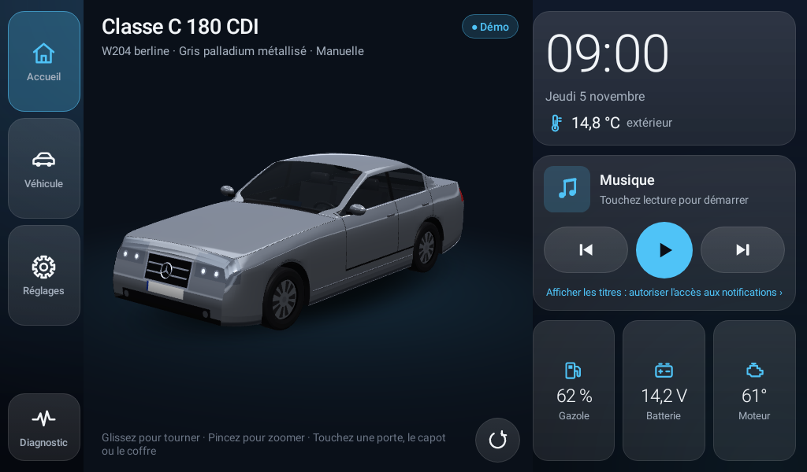

# W204 Dash

Tableau de bord Android façon « CarPlay personnalisé » pour l'écran d'une
Mercedes-Benz Classe C berline W204 (C 180 CDI, OM 651, 2011), en paysage,
avec la voiture en 3D.

- **APK prêt à installer** : [`livrable/W204Dash.apk`](livrable/W204Dash.apk)
- **Guide d'installation (clé USB, sources inconnues, dépannage)** : [`livrable/LISEZMOI.txt`](livrable/LISEZMOI.txt)
- **Captures d'écran** : [`livrable/captures/`](livrable/captures)



## Fonctions

| Écran | Contenu |
|---|---|
| Accueil | Voiture 3D à tourner au doigt (pincer = zoom), portes / capot / coffre qui s'ouvrent au toucher, horloge, température extérieure, widget musique, infos rapides |
| Véhicule › Ouvrants | 4 portes, capot, coffre (vue de dessus + liste) |
| Véhicule › Radars | Distances avant / arrière, bip optionnel |
| Véhicule › Infos | Vitesse, régime, temp. extérieure, batterie, kilométrage, gazole, ceinture conducteur, lave-glace (+ temp. moteur, clim, rapport) |
| Véhicule › Entretien | Prochaine révision (date / km) et historique saisi à la main |
| Réglages | Couleur, options (texte libre), boîte manuelle / auto, modèle 3D, source de données, thème, test de connexion |
| Diagnostic | Détection du boîtier CAN de l'écran + journal en direct, enregistrable |

## Sources de données (`app/src/main/java/com/rayan/w204dash/data`)

Interface `DataSource`, trois implémentations (+ une combinée) :

1. **`DemoDataSource`** (par défaut) : diesel simulé, ralenti ~750 tr/min,
   14,1 V moteur tournant, cycle de conduite de 90 s.
2. **`Obd2DataSource`** : ELM327 Bluetooth classique (SPP), PIDs standards
   0D vitesse, 0C régime, 46 temp. extérieure, ATRV / 42 tension,
   2F carburant, 05 liquide de refroidissement, A6 kilométrage.
   Détection des PIDs supportés, reconnexion automatique.
3. **`HeadUnitDataSource`** : boîtier CAN de l'écran. `HeadUnitProbe`
   détecte la plateforme (FYT/SYU, MTC, TopWay…), liste les applis,
   services, fournisseurs et ports série liés au véhicule, puis extrait du
   code de ces applis les noms de broadcasts candidats et les écoute.
   `CanExtrasParser` interprète les extras (door, belt, temp, fan…).
4. `CompositeDataSource` : OBD2 pour le moteur + écran pour le reste.

### Écrans « Carocean / Yecon » (UIS8581, Mercedes W204)

Analyse de l'appli CAN d'origine (`com.can.activity`, CaroceanBenzCanZH) :
l'état des ouvrants vient du microcontrôleur via un `Messenger` Android.
`McuDoorLink` fait la même chose :

- liaison à l'action `com.carocean.mcuservice` (paquet `com.carocean.mcuserver`) ;
- message `0x100` avec `Bundle{"cmdcode": int[]{0x12}}` et `replyTo` (désabonnement : `0x101`) ;
- réception de messages `0x102` : `"cmdcode"` = `0x12`, `"data"` = octets ;
  `data[3]` = masque `0x80` porte AVG, `0x40` AVD, `0x20` ARG, `0x10` ARD,
  `0x08` coffre, `0x04` capot (1 = ouvert) ; `persist.sys.front.door` /
  `persist.sys.rear.door` inversent gauche et droite.
- Marche arrière : broadcasts `com.yecon.action.BACKCAR_START` / `BACKCAR_STOP`.
- Sur cet écran, l'appli d'origine ne reçoit pas la clim ni les infos moteur
  par cette voie (code présent mais non alimenté).

Solution de secours : `CanWindowReader` (service d'accessibilité) lit la
fenêtre « porte ouverte » affichée par l'appli CAN.

Une valeur inconnue vaut `NaN` / `-1` et s'affiche « -- ».

## Modèle 3D

- Rendu OpenGL ES 2.0 maison (`gl/`), dessiné seulement quand quelque
  chose bouge (économe pour les écrans peu puissants).
- Le modèle est **un seul fichier** : `app/src/main/assets/models/car.glb`.
  Le modèle actuel est **provisoire**, généré par
  `tools/generate_w204_glb.py` (berline W204 simplifiée, pièces nommées).
- Pour le remplacer sans recompiler : Réglages › Modèle 3D › Importer un .glb.
  Pièces animées si nommées `door_fl`, `door_fr`, `door_rl`, `door_rr`,
  `hood`, `trunk` (ou porte/capot/coffre) ; charnières calculées
  automatiquement ; peinture reconnue par le nom du matériau (`paint`…).

## Compatibilité

- `minSdk 16` (Android 4.1), `targetSdk 34`, aucune dépendance (ni AndroidX,
  ni Play Services), fonctionne hors ligne.
- Le code hors du paquet `compat/` est **compilé contre l'API 16** pendant la
  construction : tout appel à une API plus récente fait échouer la compilation.

## Compiler

```bash
./build.sh            # -> livrable/W204Dash.apk (signé avec tools/debug.keystore)
tools/run_tests.sh    # tests sur PC : .glb, ouvrants, sélection au doigt, OBD2, CAN, démo
```

Prérequis (Ubuntu/Debian) : JDK 17+, `apt install aapt zipalign apksigner
dalvik-exchange`, et `android.jar` des API 16 et 34 dans
`/opt/android-local/platforms/android-XX/` (ou variable `ANDROID_JARS`).

Android Studio peut aussi ouvrir le projet (`settings.gradle`,
`app/build.gradle`, même clé de signature) ; cette voie n'a pas pu être
essayée ici (dépôt Google Maven inaccessible), `build.sh` est la référence.

### Vérifications supplémentaires

- `tools/robotest/` : lance l'appli dans Android 14 simulé (Robolectric),
  ouvre tous les écrans et onglets, produit les captures
  (`gradle test -Pscreens`).
- `tools/preview/` : rend la voiture avec **les shaders de l'appli** dans
  WebGL (même langage GLSL ES 1.0) pour vérifier qu'ils compilent.
